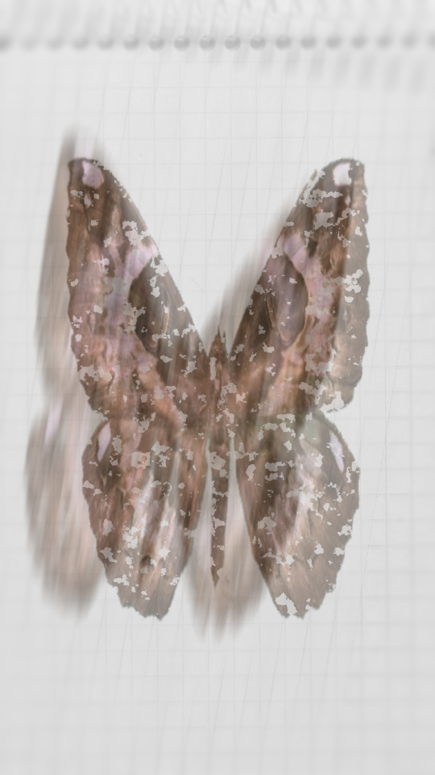
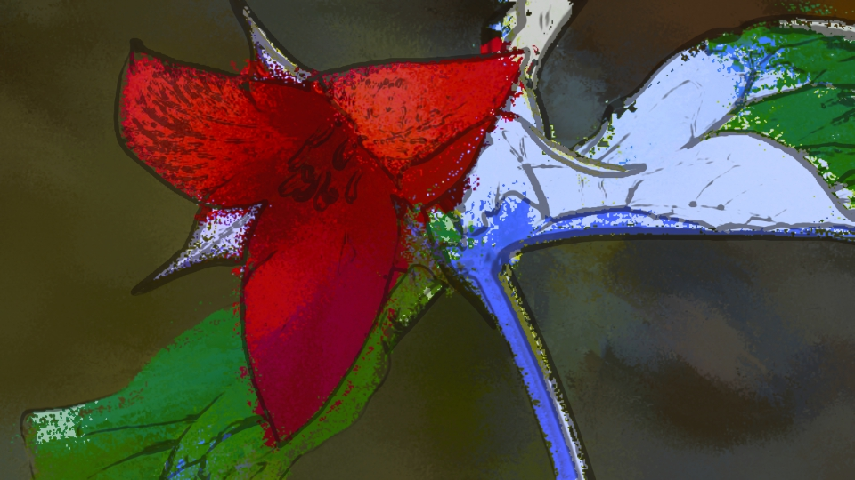
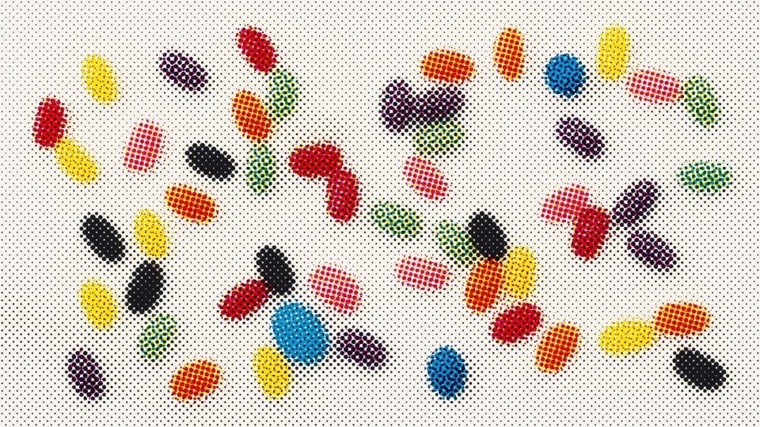
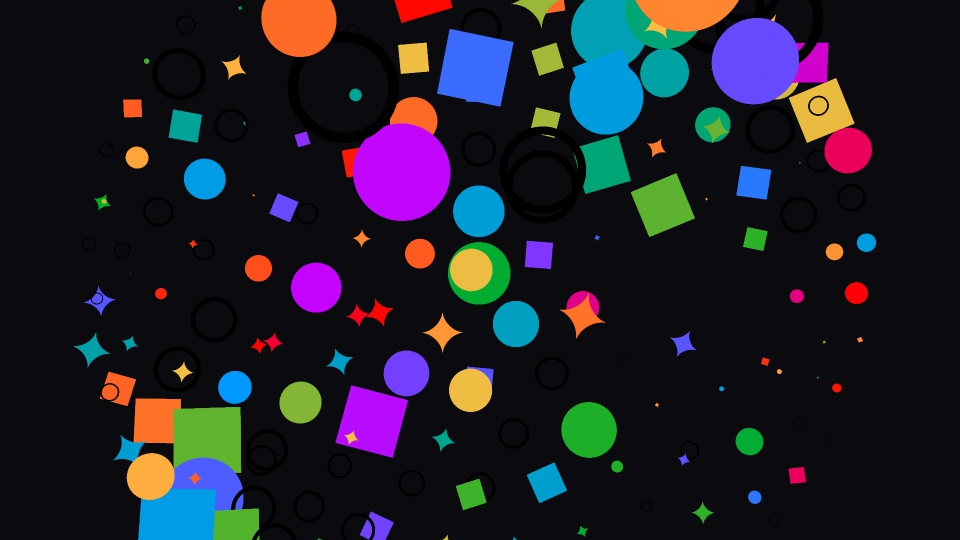

# TouchDesigner components

Four drop-in `.tox` components for TouchDesigner: three TOP effects and a texture instancer. Each one is a
single self-contained COMP with its parameters on custom pages. Images it needs are embedded and its
shaders are inside the component, so nothing has to sit next to the file.

| | Component | What it does |
|---|---|---|
|  | [**FlipBook**](#flipbook) | Turns a TOP into a hand-flipped book: stop-motion timing, paper, notebook, grain, page-flip ghost, lens blur. |
|  | [**Paint**](#paint) | Painterly filter: anisotropic Kuwahara brush strokes, tone steps, paper, ink outline, mask. |
|  | [**Halftone**](#halftone) | Halftone screen: rotated dot grids per channel, RGB light / CMYK ink / mono, polygon or ring dots, glow. |
|  | [**Texture Instancer**](#texture-instancer) | Instances a folder of images or movies on POP points, with ordering, size, drift, spin and colour controls. |

These are version 2 of components first made in 2025. Each one keeps the old parameters and look and adds to
them; the changes are listed per component below.

## Use

TouchDesigner 2025 with POPs (built and tested on 2025.32820). Drag a `.tox` into a network, wire the input, and use the custom
parameter pages. With nothing wired in, each component shows a built-in demo input, so you can see it work
straight away. The *About* page has the version.

## FlipBook

`flipbook/flipbook.tox` · input: TOP · output: TOP

The input is held and only updated on each "flip" (*Flips per Second*), like a drawing redrawn on every page.
On every flip the sheet shifts a little, the paper texture changes, new grain appears, the brightness flickers,
and a smeared, tilted copy of the page flashes over it and fades (*Page Flip Ghost*). The edges of the frame
get a lens blur. Drawings with alpha sit on the notebook; for opaque footage use *Blend = Multiply*.

- **Flip Book**: Play, Flips per Second, Reset, Resolution, Fit Input, Zoom, Offset, Image Jitter, Page Shake / Rotate / Scale, Flicker
- **Style**: Blend (Over / Multiply / Darken), Paper (texture, displace, random order, colour), Notebook (opacity, displace), Grain (amount, size, density), Brightness, Contrast, Ink Tint, Page Flip Ghost (opacity, fade, rotate, offset, alternate sides)
- **Blur**: Pre-Shrink, Softness, Lens Blur (size, sharp area, falloff)
- **Paper Files**: your own paper atlas (grid of frames) and notebook image; empty = the built-in ones

Changes from v1: the paper frames and notebook are embedded (v1 needed a `files/` folder next to the project and
broke when it was missing); Play no longer depends on a keyboard CHOP and the timing doesn't reference
parameters outside the component; the image chain is now two shaders instead of dozens of operators; any output
resolution (v1 was fixed at 2048 × 2048); new: blend modes, own paper/notebook files, ink tint,
brightness/contrast, ghost and vignette controls, Reset.

## Paint

`paint/paint.tox` · inputs: TOP, mask TOP (optional) · output: TOP

A structure tensor finds the direction of the strokes, a Gaussian blur smooths that flow, and an anisotropic
Kuwahara filter paints along it: each pixel takes the flattest of eight elliptical sectors. The result is then
quantised into tone steps, saturated, tone-mapped and multiplied with paper.

- **Stroke**: Brush Size, Stroke Stretch, Sharpness (32 = hard pick, lower = softer), Flow Smoothing, Process Scale, Quality
- **Color and Paper**: Tone Steps, Shadow / Highlight Level, Saturation, Tone Map, Exposure, Gamma, Paper Strength / Scale / Contrast / Image, Paper Reveal, Paper Colour, Background, Mix Original
- **Outline**: ink line along strong edges (amount, threshold, softness, colour)
- **Mask**: Use Mask, Invert. Input 2's alpha cuts the result out, and the output carries that alpha.

Changes from v1: the stroke field is smoothed (strokes follow the image more calmly) and the orientation maths
is fixed; *Sharpness* blends sectors instead of always picking one; *Process Scale* (default 0.5) paints at a
lower resolution with the same brush size; the paper is a 2048 px mono texture (v1 locked a 3600 × 4800 image
into the file); no black border at the frame edge; new: outline, paper reveal, exposure/gamma, mix, mask invert,
shadow/highlight levels, own paper image.

## Halftone

`halftone/halftone.tox` · input: TOP · output: TOP

One shader draws a rotated dot grid per channel. Each dot reads the average of its cell (from a mipmap) and
is sized by it; overlapping dots keep the strongest coverage. Dots can be polygons (3 to 24 sides) or rings.

- **Halftone**: Mode (RGB light, CMYK ink, Mono ink), Cell Size, Dot Size, Zoom, Area-correct Tone, Dot Sides, Dot Rotate, Rings, Ring Width, Edge Softness, Angles per channel, Misregistration, Rotate Plates, Plate Scale Spread, channel on/off
- **Color**: Saturation, Input Saturation / Gamma / Contrast, Black Generation, Invert (mono), Background, Paper, Custom Inks
- **Glow**: Glow, Glow Size, Trails, Reset Trails
- **Output**: Use Input Resolution or a custom Resolution

*Rotate Plates = 1* brings back v1's look, where each channel's picture turns with its screen angle.

Changes from v1: v1 instanced dots into four 4096 × 4096 renders (about 70 ms CPU + 40 ms GPU per frame on Ro's
Mac); v2 is one pass at the input resolution (about 1.5 ms GPU). New: CMYK and mono modes, ring and
polygon dots without geometry, area-correct tone, misregistration in pixels, custom inks, glow trails. The
unused *Edge* parameters are gone.

## Texture Instancer

`texture-instancer/texture_instancer.tox` · inputs: points POP, shape POP (optional) · outputs: render TOP, texture array TOP, points POP

Point it at a folder (*Texture Folder*). Every image or movie is fitted into a square, packed into one atlas
and turned into a 2D texture array, one layer per file. Each point gets a quad with its own layer, size,
rotation and colour, written by one GLSL POP. The render uses the built-in orbit camera
(TouchDesigner's `cameraViewport`) or your own (*Camera*).

- **Textures**: Texture Folder, Maximum Textures, Texture Size, Play Movies / GIFs, Reload Folder, Blending, Alpha Threshold, Edges (off / only / over) with strength and colour
- **Sorting**: Texture Order (sequential, random, along X / Y / Z, from centre), Seed, Shuffle, Auto Shuffle (+ interval), Cycle Speed
- **Scale and animation**: Size, Size Mode (constant, noise, wave), Random Variance, Noise Frequency / Speed, Wave Speed / Axis / Wavelength / Minimum, Drift, Drift Frequency, Face Camera, Random Rotate, Spin
- **Color**: Color Mode (off, random from palette, one per texture, image at point XY), Palette / Image TOP, Tint Amount, Use Point Color
- **Scene**: Resolution, Background Colour / Alpha, Camera, Anti-Alias

Changes from v1: input is a POP (v1 took a SOP and went through CHOPs); no 30-texture limit (a test folder of
204 GIFs runs at about 1.5 ms CPU per frame); textures keep their aspect ratio; the ffmpeg palette step is
replaced by sampling a TOP directly; per-instance rotation, spin, drift and camera-facing are new; v1's
broken instance setup (mismatched instance counts, hard-coded `/project1` paths, render size taken from
parameters that didn't exist) is gone. *Play Movies / GIFs* makes the atlas rebuild every frame, which costs
a lot with hundreds of files; leave it off for stills. The first load of a big folder takes a few seconds.

## Repo layout

| File | What it is |
|---|---|
| `flipbook/flipbook.tox` | FlipBook component. |
| `flipbook/preview.jpg` | Preview (TouchDesigner sample image `Butterfly1.tif`). |
| `paint/paint.tox` | Paint component. |
| `paint/preview.jpg` | Preview (`Trillium.jpg`, outline on). |
| `halftone/halftone.tox` | Halftone component. |
| `halftone/preview.jpg` | Preview (`Jellybeans.1.jpg`, CMYK). |
| `texture-instancer/texture_instancer.tox` | Texture Instancer component. |
| `texture-instancer/preview.jpg` | Preview (built-in shapes, random palette colours). |
| `glsl/flipbook_page.glsl` | FlipBook pass 1: one page (paper, notebook, jitter, grain, blend). |
| `glsl/flipbook_flip.glsl` | FlipBook pass 2: the page-flip ghost. |
| `glsl/flipbook_vignette.glsl` | FlipBook lens-blur mask. |
| `glsl/paint_tensor.glsl` | Paint pass 1: structure tensor. |
| `glsl/paint_kuwahara.glsl` | Paint pass 2: anisotropic Kuwahara. |
| `glsl/paint_grade.glsl` | Paint pass 3: tone steps, colour, outline, paper, mask. |
| `glsl/halftone.glsl` | Halftone screen. |
| `glsl/halftone_trail.glsl` | Halftone glow trails (feedback). |
| `glsl/instancer_attribs.glsl` | Texture Instancer GLSL POP: per-point layer, size, colour, rotation, facing, drift. |
| `glsl/instancer_array.glsl` | Texture Instancer: atlas to 2D texture array. |
| `assets/flipbook/paper_atlas.png` | The ten paper frames (5 × 2 grid, mono). Embedded in `flipbook.tox`. |
| `assets/flipbook/notebook.png` | Notebook sheet (mono). Embedded in `flipbook.tox`. |
| `assets/paint/paper.png` | Paper texture (2048 px, mono). Embedded in `paint.tox`. |
| `tools/common.py` | Helpers shared by the build scripts (operators, shaders, parameter pages, embedding images). |
| `tools/build_flipbook.py` | Builds FlipBook from the files above. |
| `tools/build_paint.py` | Builds Paint. |
| `tools/build_halftone.py` | Builds Halftone. |
| `tools/build_instancer.py` | Builds Texture Instancer. |
| `tools/test_all.py` | Rebuilds all four, checks them, exports the `.tox` files and re-imports them. |
| `tools/perf.py` | Measures a component's average cook time over N frames. |
| `tools/make_previews.py` | Renders the preview images. |

## Rebuilding

The `.tox` files are built from `glsl/`, `assets/` and `tools/`. To change a component, edit those and run
in TouchDesigner (Textport or a Text DAT; the scripts use absolute paths at the top, so change `REPO` if the
repo is somewhere else):

```python
exec(open('/path/to/td-components/tools/test_all.py').read())
# a few seconds later:
print(op('/project1/td_components_test/tests').module.report())
```

That rebuilds `/project1/flipbook`, `/paint`, `/halftone` and `/texture_instancer` (replacing COMPs with
those names), then checks each one: no errors, every shader compiles, the output isn't empty, it changes when
an input is wired and when a key parameter changes, the exported `.tox` reloads without errors, gives the same
output and still holds its embedded images.

© Ro Mayz 2026. All rights reserved.
